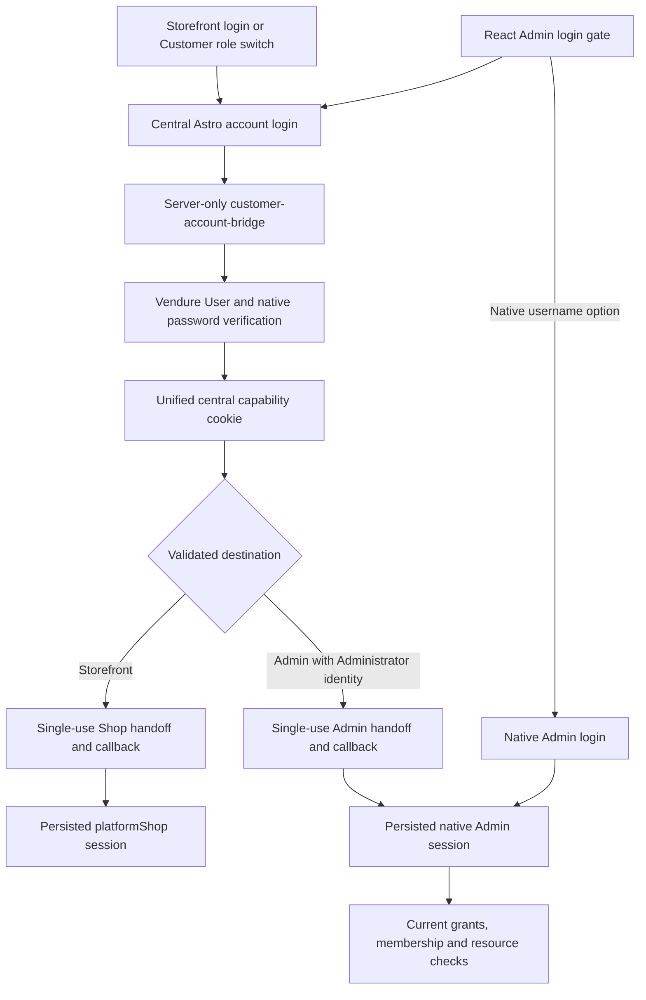

# Authentication and account access consolidation audit

Audit date: October 30, 2026. Investigation only. No application changes or recommendations were implemented.

## 1. Executive Summary

The platform already has much of the infrastructure needed for centralized authentication. Both frontends use Vendure identities and native password credentials. Astro already provides a central email/password login, registration, phone verification, email proof, recovery, and role onboarding. A central password session can issue a separate Customer or Admin session through an expiring, single-use handoff. Consolidation should finish and consistently expose this infrastructure rather than replace the identity provider.

The fragmentation is real, but it is not two independent password databases:

- **Verified current behavior:** React/Vite on port 4322 renders its own login gate, with a central account option and a native Administrator username/password option. Astro on port 4321 serves both merchant storefronts and the central account host. Different origins on the same port have different account behavior.
- **Verified current behavior:** Customer sessions use the persisted `platformShop` purpose. Admin handoff sessions use `native`. A Customer session cannot authorize Admin requests even when the underlying User has Vendor permissions. This boundary is intentional and must remain.
- **Verified current inconsistency:** Customer header switching requests the central handoff through `account=1`, but workspace links in account settings and `CentralAccount.astro` omit that marker. They depend on an already usable Admin session or another login interaction. A successful Customer login alone does not make those links authenticated Admin navigation.
- **Verified current limitation:** The optional email-link system is Customer-only. It explicitly excludes Administrator-backed identities and cannot issue an Admin handoff. Its central capability and cookie are distinct from the password account capability and cookie.
- **Verified current behavior:** Signup is implemented, requires personal SMS phone verification, and does not log the new person in automatically. Optional email proof is separate and is required for password recovery. Submitting role onboarding currently creates a newly owned Vendor or Market and fixed channel permissions; it does not require the historical review-first process described in older reports.
- **Existing but incomplete:** Custom-domain handoff and host resolution are implemented at the application layer. Seamless navigation, universal magic-link login, a uniform destination selector, complete global logout, and browser-independent Admin cookie compatibility are not complete.

The reported Customer-to-Vendor denial has a verified architectural explanation and concrete integration candidates, but its exact historical cause cannot be proven from source alone. It is intentional to deny reuse of a Customer credential as an Admin credential. It is an integration problem when an authorized person is routed to a workspace without completing the existing Admin handoff, loses their requested channel, or encounters an unrelated existing Admin session. Section 4 separates those cases.

Scope and evidence: this audit followed account pages, their direct API clients and bridges, identity/session services, tenant authorization, onboarding, and installed Vendure authentication dependencies. `W` below means `E:/coding/farmers-market-platform-web`; `B` means the actual local backend, `E:/coding/farmers-market-platform`. The requested `farmers-market-platform-api` name does not match the available sibling folder; [the demo launcher][w-demo] explicitly selects `B`. Source was inspected at frontend HEAD `c4a3c7d` and backend HEAD `e06130b`, including existing uncommitted changes. Existing reports were treated as historical evidence, not current authority. No environment secrets, database state, running sessions, or delivery services were queried. No tests, lint, typechecks, builds, migrations, browsers, servers, or UI automation were run. “Verified” means verified in this local source snapshot, not reproduced at runtime or confirmed installed in the persistent test database.

## 2. Current Authentication Entry Points (route inventory table)

Local origins: `A = http://auth.platform.localhost:4321` for the central account; `D = http://localhost:4322` for React Admin. These exact values are enforced by [localAccountEnvironment()][w-local-env] for the persistent demo launcher. `S` means an active, backend-resolved storefront origin served by Astro on port 4321 locally. A route at `localhost:4321` is not automatically the central account route. Backend HTTP defaults shown here are `/customer-account-bridge`, `/shop-api`, and `/admin-api` on the configured backend, locally port 3000.

In the table, “bridge” means same-origin Astro `POST /api/account`, then the server-only CustomerAccountController and CustomerAccountService. All ordinary account forms reuse Astro `SiteLayout`, the Astro Button adapter, and presentation tokens, but the forms themselves are separate implementations. React's login form shares primitives and tokens, not the Astro login form or controller.

| Exact route and application | Source / entry | Backend and logic | Eligible accounts | Successful result and UI sharing |
| --- | --- | --- | --- | --- |
| `A/account/login`; `S/account/login` redirects to it | [login.astro][w-login], `centralSignIn()` in [account.ts][w-account] | Bridge `unifiedTarget`, `unifiedLogin`, `unifiedAuthorize`; shared native User password verification | Verified Users with an email identifier and an unambiguous same-User Customer profile, or eligible Administrator for whom that profile can be attached; missing phone diverts to enrollment | Without a target: central `/account`, or Vendor application continuation. With a target: Shop `/auth/callback` or Admin `/auth/account`. Dedicated Astro password form; distinct from magic-link and React forms |
| `D/`, `/vendor`, `/vendor/*`, `/market`, `/market/*`, `/platform`, `/platform/*` when anonymous | [AdminApp.tsx][w-admin-app], [main.tsx][w-main] | Central option calls `platformAccountLogin()`; native option calls Admin GraphQL `login`, then `me` and context bootstrap | Central option follows the above rules; native option requires native Administrator identity, including non-email usernames; protected access additionally needs phone and grants | One conditional React login UI across these URLs, not a separate implemented `/login` page. Existing path stays in effect for native login; authorized channel/context determines shell |
| `D/auth/account?code=...` | [account-login.ts][w-admin-login], `completePlatformAccountLogin()` | Admin `exchangePlatformAdminHandoff(code, correlation)` | A valid Admin-purpose handoff for an existing live Administrator | Sets backend session cookie; removes code from browser history; restores saved allowed `/vendor` or `/market` destination, otherwise `/`; same React bootstrap, no credential form |
| `A/account/sign-in`; `S/account/sign-in` redirects centrally | [sign-in.astro][w-magic] | Bridge `target`, `request`; existing unified/password cookie may authorize a Shop handoff first | Email-link issuance is only for eligible Customer-only identities; existing phone identity must have matching verified email | Generic request receipt; sends `/auth/claim?token=...`. An existing suitable central capability can skip the form and return to the storefront. Independent email-link form, shared account layout only |
| `A/auth/claim?token=...` | [claim.astro][w-claim] | Bridge `claim`; Customer `MAGIC` capability | Eligible Customer-only identity with a valid unused email capability | Explicit POST consumes link. Existing phone: legacy central cookie, then original storefront `/account/sign-in` and handoff. Missing phone: restricted enrollment at `/account/phone`. No Admin authority; shared layout and button only |
| `S/auth/callback?code=...` | [callback.ts][w-callback] | Shop `exchangeCustomerHandoff`, through Astro cookie transport | Valid Customer-purpose handoff for the exact storefront, channel, origin and browser correlation | Receives `platformShop` session; validated return path defaults to `/account`; optional application progress binding. Failure goes to `/account/sign-in?retry=1` or Vendor application help. No login form |
| `A/account/signup`; `S/account/signup` redirects centrally | [signup.astro][w-signup], [SignupPasswords.tsx][w-signup-passwords] | Bridge `register`; `AccountPhoneService.stagePassword()` and `request()` | New identity, with unique personal phone and no conflicting User/Customer email at activation | Stages password hash and SMS challenge, then `/account/verify`. Does not create a business or grant Admin access. Shared password validation/UI helper, separate registration form |
| `A/account/verify` | [verify.astro][w-verify] | Bridge `phoneRegistrationStatus`, `resendPhoneRegistration`, `verifyPhoneRegistration` | Valid signup challenge and matching client binding | Creates User, Customer, native credential and phone identity atomically after correct SMS; then `/account/login?verified=1`, preserving validated signup continuation when available. Dedicated OTP UI |
| `A/account/phone`; noncentral access redirects through login | [phone.astro][w-phone] | Bridge `centralProfile`, `requestPersonalPhone`, `verifyPersonalPhone` | Password-authenticated account missing/changing phone, or restricted Customer email-link enrollment | Binds/replaces verified personal number. Normal success returns to `/account`; legacy email enrollment can continue to the original storefront. Reuses PhoneInput, distinct forms |
| `A/account/admin-phone` | [admin-phone.astro][w-admin-phone] | Bridge `requestAdministratorPhone`, `verifyAdministratorPhone` | Existing verified Administrator with correct native identifier/password, including non-email username | Adds phone proof to the same User; no new session, role or identity; user returns to native Admin sign-in. Reuses PhoneInput, distinct recovery/enrollment UI |
| `A/account/email-verify?token=...`; request action in `A/account/settings` | [email-verify.astro][w-email-proof], [CentralAccount.astro][w-central-ui] | Bridge `requestEmailProof`, `verifyEmailProof` | Signed-in unified account with phone proof; token must match that principal, Customer and current identifier | Records separate verified mailbox proof, consumes token, returns `/account?saved=1`. Does not grant a business role. Separate confirmation UI |
| `A/account/recover`; `S/account/recover` redirects centrally; React login links here | [recover.astro][w-recover], [AdminApp.tsx][w-admin-app] | Bridge `requestRecovery` | Recovery is issued only for a verified, live native email identity with Customer profile and matching verified email proof | Uniform receipt, then email to `/account/reset?token=...` if eligible; otherwise generic login link when delivery is configured. One current browser recovery form |
| `A/account/reset?token=...`; other hosts return 400 | [reset.astro][w-reset] | Bridge `resetPassword` -> `resetCentralPassword()` -> native `UserService.resetPasswordByToken()` | Holder of valid reset capability, native reset state and current matching mailbox proof | Changes native password, removes all Vendure authenticated sessions and consumes both capability namespaces; redirects to login with `security=1`. Separate reset form; shared password rule contract |
| `A/account/settings` password change | [settings.astro][w-settings], [CentralAccount.astro][w-central-ui] | Bridge `changePassword` -> `changeCentralPassword()` | Unified account with current password and phone proof | Same credential changes and broad session/capability revocation; login required again. Settings form, not another forgot-password implementation |
| `A/account/onboarding/vendor`, `A/account/onboarding/market`; same paths at `S` redirect centrally | [[role].astro][w-onboarding] | Bridge `saveOnboarding`; `AccountOnboardingService.save()` | Unified phone-verified account; per-role lifecycle and revision checks | Save draft or explicitly finish new owned business signup. Current submit path completes provisioning synchronously. One parameterized onboarding page for both roles |
| `/account` and `/account/settings` at `A` or `S` | [index.astro][w-account-index], [settings.astro][w-settings], [CustomerLayout.astro][w-customer-layout], [customer-dashboard.ts][w-customer-api] | Central capability via bridge at `A`; Shop profile/contexts at `S` | Valid account for the selected session surface | Protected dashboard; failed authentication returns through login or phone verification. Header has role/business selection; settings also has independent workspace links. No general “switch to a different person” route |
| `D` authenticated header mode and Business selectors | [AccountModes.tsx][w-modes] | Admin `ownPlatformAccountContexts`, `me`, exact channel restore, tenant identity queries | Current authorized affiliations; Platform option only when current context is Platform | Vendor/Market switch changes URL and reloads context/services; Customer goes to central `/account/login`. Shares AccountModeSelect with Customer layout; different controllers |
| `S/vendor/application-continue?slug=...` or `?claim=...`; `A/account/vendor-applications` | [application-continue.ts][w-vendor-continue], [vendor-applications.astro][w-vendor-account], [vendor-application-access.ts][w-vendor-access] | Central login/signup and `applicantApplications` authority check, then existing unified Shop handoff | Authenticated Vendor owner, or person who explicitly completes new Vendor onboarding; Customer-only/staff cannot claim owner access | Central page selects authorized Vendor; returns via `S/auth/callback` to `/vendor/application-return`. Specialized onboarding continuation, not separate identity registration |
| `S/vendor/application-continue?draft=...&vendor=...`, `D/vendor/applications/continue`, `S/vendor/application-return?...` | [application-continue.ts][w-vendor-continue], [application-continuation.tsx][w-admin-continuation], [application-return.astro][w-vendor-return] | Admin applicant `CONTINUE` -> `vendorApplicationHandoff()` -> existing Shop exchange | Current authorized Vendor owner and matching draft | Separate Admin-to-Shop handoff for application editing; rechecks Vendor ownership on return. Business ID or draft query alone does not authorize access |
| `S/account/application-signup?application=...`, `S/account/applications/claim/:id` | [application-signup.ts][w-app-signup], [claim/[id].astro][w-app-claim] | Redirect adapters to the Vendor continuation above | Valid application ID; signup adapter also requires existing claim cookie | No new account logic. Claim/ownership proof remains required downstream. `/account/applications/[...id]` and `/account/applications/drafts/:id` now return 410 for legacy management |
| `POST A/api/account`, `POST S/api/account` with `action=logout`; `A/auth/logout`; `A/auth/signed-out` | [api/account.ts][w-account-post], [logout.astro][w-logout], [signed-out.astro][w-signed-out] | Central `unifiedLogout`/legacy `logout`; storefront `customerSignOut` first | Respective valid sessions | Storefront POST clears current Shop session, then opens central logout confirmation. Central POST clears central cookies; `everywhere=true` expands Customer revocation. Admin sessions are not revoked by unified central logout. Shared account layout; separate confirmation |
| `D` Sign out button, any authenticated shell | [AdminApp.tsx][w-admin-app], [auth package][w-auth] | Native Admin GraphQL `logout` | Current Admin session | Clears visible tenant state immediately. Installed Vendure logout deletes all authenticated sessions for that User, including Shop sessions, but does not consume custom central capabilities. No dedicated logout page |
| `POST S/api/shop`: `login`, `session`, `logout`, `purchase-account-link` | [api/shop.ts][w-shop-post], [checkout.ts][w-checkout-api], [ShopSignIn.tsx][w-shop-signin], [PurchaseSuccess.tsx][w-purchase] | Shop `authenticate(platformShop)`, bootstrap, `customerSignOut`, `requestPurchaseAccountLink` | Direct password strategy excludes Administrator-backed Users; purchase link requires owned committed purchase | Compatibility API, not another current credential form. ShopSignIn links to central password login; purchase success offers Customer email link. Local logout only for this API action |

The backend also configures the scaffold Vendure Dashboard at API-origin `/dashboard` through `DashboardPlugin`. It is an additional native Admin surface in development if its built assets exist, not the React app on 4322. [Production HTTP middleware][b-http] explicitly rejects `/dashboard` in production. Asset existence and its bundled internal routes were not audited. Native GraphQL account mutation names in generated schemas are not evidence of another supported public UI: [ShopContextMiddleware][b-shop-policy] blocks native registration, verification and reset operations when central accounts are enabled.

## 3. Current Login and Session Architecture

**Verified identity and password path.** [CustomerAccountService.unifiedLogin()][b-account] normalizes and validates an email identifier, applies durable limits, loads the existing Vendure User, and calls `AuthService.verifyUserPassword()`. It rejects deleted, unverified or incorrect credentials. `unifiedCustomer()` serializes attachment, rejects ambiguous/conflicting Customer records, and can create a Customer profile for an existing live Administrator using the same User. It adds only the native Customer role, not business grants. A matching email in a different Customer record is a conflict, not permission to merge identities.

Native Admin login uses Vendure `NativeAuthenticationStrategy` through `createAdminSession().login()`. Both paths check the same `NativeAuthenticationMethod.passwordHash` for the same User. The inspected installed [Vendure default configuration and hashing strategy][b-default-config] use bcrypt with 12 rounds. There is no frontend-owned password store. Current signup/reset/change policy is 12 to 72 printable ASCII characters, including uppercase, number and symbol, enforced by [backend password-policy.ts][b-password-policy] and its frontend counterpart. Existing login accepts older valid credentials without applying the new-password complexity rule. A legacy email-enrollment path still uses a 12 to 128 UI/service length check before native validation, rather than this full rule.

The central session is an opaque database-backed capability, not a Vendure browser session or JWT. [capability(), take(), unifiedBound(), unifiedAuthorize(), exchangeAdmin(), exchange()][b-account] store SHA-256 digests of 32-byte random values, purpose, principal/Customer/email binding, expiration, consumption state, target origin/storefront and correlation digest. Redemption uses transaction locks and validates those bindings. Handoff issuance consumes and rotates the old central capability. Admin handoff requires a live Administrator both at issuance and redemption, then creates a `native` authenticated session. Shop exchange creates `platformShop`; it never forwards an Admin cookie to a merchant.

| Credential / state | Browser storage and scope | Expiry and authority |
| --- | --- | --- |
| `platform-unified-account` | HttpOnly, host-only central cookie, `Path=/`, `SameSite=Lax`, Secure for HTTPS | Cookie max-age seven days; backend default central TTL seven days. `UnifiedAccountCapability` is authoritative. Password login or legacy phone enrollment can establish it |
| `platform-account` | Separate central host-only HttpOnly cookie with the same flags | Legacy Customer-only `CustomerAccountCapability` central state; default seven days. Not interchangeable with unified central state |
| Vendure `session` plus signature | Default `cookie-session` cookie, signed using `COOKIE_SECRET`; HttpOnly, `SameSite=Lax`, `Path=/`, Secure in production; no Domain configured | Contains opaque session token. Persisted `AuthenticatedSession` holds strategy, User, invalidation and expiry. The installed default session duration is **one year**, not seven days; project config does not override it |
| Handoff code | Query on destination callback, consumed through server/GraphQL exchange | Default 60 seconds, exact purpose/target/correlation, single use; no refresh token |
| Correlation and return cookies | Storefront: HttpOnly, callback-path cookies. Admin: browser-written callback-path cookies, so not HttpOnly | Ordinary correlation 120 seconds; storefront signup/application continuation can use 30 minutes. Admin destination only admits allowed workspace paths |
| Signup SMS challenge | HttpOnly `phone-challenge`, `SameSite=Strict`, ten-minute browser max-age | Challenge itself initially expires after five minutes; backend state, keyed OTP MAC, client binding, attempt and resend limits control validity |

Cookie details were verified against [account.ts][w-account], [account-login.ts][w-admin-login], [vendure-config.ts][b-config], installed `B/node_modules/@vendure/core/dist/bootstrap.js`, `api/common/set-session-token.js`, `config/default-config.js`, and `@vendure/common/lib/shared-constants.js`. Remembered handoffs set a one-year browser max-age; native Admin login uses `rememberMe:false`, normally a browser-session cookie. Installed SessionService can extend persisted session expiry during refresh. There is no access-token/refresh-token pair in these web flows. The backend also accepts bearer session tokens and emits `vendure-auth-token`; the inspected web transport uses credentialed cookies, not browser localStorage for auth tokens.

**Backend sharing does not mean cookie sharing.** [AccountSessionAccessStrategy.canAccess()][b-session-policy] reloads persisted authenticated session state, rejects missing/invalidated/expired/deleted state, requires personal phone identity for non-public protected access, and rejects `platformShop` on Admin APIs. Conversely, Admin-native credentials for Administrator Users cannot authorize Shop protected access. Shop permissions are restricted to Public, Owner and Authenticated checks; User business grants do not become Shop operational authority. The User may still have the same role rows, and native `me` uses the User's channel/permission projection. It would be inaccurate to describe this as a separate reduced-role JWT. Session purpose and API policy enforce the distinction.

**Browser transport.** [Astro requestOptions()][w-shop] forwards the request's cookie header to the Shop API with the resolved channel token and server-only storefront bridge key. It relays Set-Cookie headers to the merchant response, so the browser cookie belongs to that merchant host. [customerApi()][w-customer-api] instead uses the central capability bridge on the central host. React calls the Admin API directly with `credentials:include`; channel requests add `vendure-token`, a context selector, not proof of authorization.

No Domain means host-only cookies, not port-specific cookies. `localhost:4321`, `localhost:4322` and backend `localhost:3000` can collide on the same `session` cookie name/path when the merchant uses literal `localhost`. Different merchant hosts and `auth.platform.localhost` have different host cookies. Config does not assign separate Shop/Admin cookie names even though Vendure supports that. Therefore the implementation has **purpose isolation at the server**, but not guaranteed separate physical cookie slots on every local hostname. Switching one local surface can replace the token presented by another, producing a denial without granting privilege.

**CORS and CSRF.** Development CORS reflects origins with credentials. Production accepts only the configured Admin origin; `productionPolicy()` rejects wildcard/extra browser origins. Production HTTP guards require the approved Origin for browser Admin mutations, while Astro Shop mutations use a server bridge without a browser Origin. Astro checks same-origin mutating requests, and account forms repeat the exact Origin check. Bridge calls authenticate the secret with a timing-safe digest comparison and exact configured account-origin header. These controls are in [middleware.ts][w-middleware], [api/account.ts][w-account-post], [CustomerAccountController][b-controller], [production-policy.ts][b-production-policy] and [production-http.ts][b-http]. CORS is not a tenant or identity authorization control.

**Redirects.** Backend `target()` requires an exact canonical origin resolved from an active provisioned storefront. Admin targets match exactly configured `adminOrigin`. Callback paths are constructed server-side. `safeAccountReturn()` admits narrow account/application continuations; `safeAdminReturn()` admits Vendor/Market roots and selected Vendor application paths. Arbitrary absolute return URLs are not accepted. This also means general deep links, some account subsections and `/platform/*` are not preserved by the existing return allowlists. Application progress has its own encrypted, origin/path/principal-bound retention mechanism in [application-progress.ts][w-progress]; it is not an authentication credential.

**Logout and expiration are inconsistent across surfaces.**

| Action | Verified effect |
| --- | --- |
| Storefront `/api/account` logout | Deletes the current Shop session/cache entry through `logoutCurrent()`, clears its cookie, then opens central `/auth/logout` confirmation. Central sign-out has not happened until that form is submitted |
| `/api/shop` `logout` | Deletes current Shop session only; no central navigation |
| Unified central normal logout | Consumes current unified central and outstanding non-central unified capabilities for the User, clears unified cookie. Existing Shop/Admin authenticated sessions remain |
| Unified central “everywhere” | Also consumes all unified central capabilities and removes that User's `platformShop` sessions/cache entries. **Does not remove native Admin sessions** |
| Legacy central logout | Separate Customer capability namespace. “Everywhere” calls native session deletion for this Customer-only identity. Legacy capabilities become unusable if the identity acquires incompatible Admin status |
| React Admin logout | Installed `BaseAuthResolver.logout()` -> `AuthService.destroyAuthenticatedSession()` -> `SessionService.deleteSessionsByUser()`: deletes all Vendure authenticated sessions for that User. Central custom capabilities survive, so central handoff can sign the person in again |
| Central password reset or change | Deletes all Vendure authenticated sessions, including Admin and Shop, and consumes every outstanding capability in both namespaces; requires a new login |

Expired central capabilities and expired/invalid Vendure sessions fail subsequent checks. Frontend guards then show login, account-unavailable, or callback retry UI; there is no unified refresh or global-expiration event. Existing reports saying Admin and Customer logout are fully independent are incomplete for the installed native logout behavior.

## 4. Account Roles, Permissions, and Switching

**Verified model.** One Vendure User can reference a Customer profile and an Administrator profile. Administrator is the technical principal profile used for Vendor and Market operations; it does not mean SuperAdmin. Business authority combines Vendure Roles scoped to Channels with [TenantMembership][b-identity-entities] rows. Membership roles are Vendor `owner`/`staff`, or Market `marketAdmin`; status is `invited`, `active` or `revoked`. Multiple membership rows support multiple businesses and Markets. SuperAdmin is a distinct privileged Role, not public signup output.

[PlatformAccountFoundation.principal(), affiliations(), own()][b-foundation] require a live verified User and personal phone record, reload current roles/channels, load active memberships, check active Vendor/Market state and exact channel permission (`ReadOwnVendorIdentity` or `ReadOwnMarket`), then return available contexts. `canApply` additionally requires Vendor owner. A role alone, a name/email match, a channel parameter, or an accepted market application is not membership proof. The affiliation list excludes inactive subjects; context bootstrap can retain a suspended Market context for limited behavior, so selector visibility and direct existing workspace behavior are not identical.

[TenantAccessPolicy][b-tenant-policy] applies server-side authorization: `currentGrants()` reloads current channel grants; `requireVendor()` resolves canonical Vendor ownership for the active channel, checks capability and target ID, reloads active membership, and restricts most management capabilities to owners. Staff access is narrower. `requireMarket()` requires exact Market channel, capability, fresh grant and active `marketAdmin` membership. Resource operations additionally check ownership. Platform management uses its own fresh SuperAdmin scope check. [resolveAdminContext()][w-admin-core] cross-checks backend identity, membership, selected channel, and permissions before exposing a shell, and `routeAllowed()` restricts the frontend route. These UI checks supplement backend enforcement.

The intended Customer-to-Vendor path is:

`CustomerLayout -> D/vendor?channel=<authorized>&account=1 -> platformAccountLogin(A) -> central unifiedAuthorize -> D/auth/account -> exchangePlatformAdminHandoff -> selectAuthorizedAccountContext -> resolveAdminContext`.

This does not copy a Customer token into an Admin context. It creates a separate authorized Admin session. With a valid unified central session it need not ask for the password again. Vendor-to-Market switching within React can reuse an existing Admin session but must restore the selected authorized channel and load the new tenant context. Customer navigation from React goes through the central account route; native Admin login by itself does not establish central state.

The reported denial must be classified at the actual failing stage:

| Case | Classification and source evidence | Implication |
| --- | --- | --- |
| Customer `platformShop` token is presented to Admin API | **Intentional session-purpose boundary**, [AccountSessionAccessStrategy][b-session-policy] | Keep denial. Issue Admin-purpose handoff for the same authorized identity |
| Central or merchant settings workspace link lacks `account=1` | **Verified integration inconsistency**, [CentralAccount.astro][w-central-ui] and [settings.astro][w-settings] versus [CustomerLayout.astro][w-customer-layout] | Link alone does not trigger account handoff. With no Admin session it shows the login gate; with a different existing Admin session it can load another account/context and deny the route |
| React arrives with `account=1` but existing session/context restore fails first | **Verified sequencing risk**, [AdminApp startup chain][w-admin-app] | The account marker is handled after restore and affiliation selection. A prior exception can reach error UI before the intended central redirect |
| Handoff succeeds but requested channel is not selected | **Verified fallback behavior**, [selectAuthorizedAccountContext()][w-admin-login] | Missing match falls back to the first affiliation. `resolveAdminContext()` gives SuperAdmin precedence, then Vendor, then Market; selected URL/scope disagreement can produce Access restricted rather than automatic role selection |
| No phone proof, live Administrator, active membership, current exact grant, or active Vendor | **Intentional authorization denial**, [foundation][b-foundation], [session policy][b-session-policy], [tenant policy][b-tenant-policy] | A successful password check is insufficient. Resolve the legitimate missing prerequisite; never bypass authorization |
| Email-link central session is used to request Admin access | **Intentional limitation of the old Customer-only mechanism**, [requestLink(), bound(), authorize()][b-account] | It cannot upgrade to Admin; a unified password session is needed today |
| Same `localhost` cookie slot was overwritten by another surface | **Configuration/integration risk supported by cookie configuration**, section 3 | Re-establish the correct session through handoff; isolate cookie storage deliberately in future work |

No runtime account/role/cookie evidence was gathered, so this audit does not claim which one caused the user's observed instance. In particular, a visible Vendor affiliation suggests the source's affiliation checks passed at rendering time, but does not prove the destination used the same principal or completed Admin session establishment.

**Can one authentication experience securely access all authorized roles?** Yes, for a compatible email-based identity, the password central capability and separate handoffs already support it. Session creation is not a grant. Destination selection must fetch current contexts, request the appropriate purpose, and retain all tenant/resource checks. Non-email Administrator identifiers, Customer-only magic links, missing phone/email proof and inconsistent entry links remain compatibility issues. No public mode switch should create a role or join an existing business.

## 5. Registration and Onboarding Inventory

| Flow | What actually happens | Authority and outstanding requirements |
| --- | --- | --- |
| Free account signup | `register()` validates names/email/phone/password, stages only a password hash and challenge. `AccountPhoneService.verify()` checks OTP, expiry, state, client binding, five-attempt limit and phone/email conflicts; atomically creates User, Customer, native credential, verified phone record and Customer role | No Administrator, Vendor, Market, Seller or business Channel at this stage. No auto-login. Email remains separately unverified |
| Guest checkout / later account claim | `setContact()` can create an unverified Customer User without usable password login, or attach permitted existing Customer-only identity to a purchase. `purchaseLink()`/`requestLink()` issue a Customer magic capability; phone enrollment can activate the account and set a native password | Checkout contact is not authenticated ownership, verified personal phone or business signup. Existing Administrator-backed email is not silently attached by anonymous checkout |
| Existing Administrator uses central password login | `unifiedCustomer()` can attach a same-User Customer profile after password verification and ambiguity checks | Preserves native credential and existing business grants; adds only Customer grant. Missing personal phone still gates protected access |
| Add Vendor role | Central onboarding saves a revisioned per-User/per-role draft. Explicit submit calls `activateOwnedSignup()`, `VendorProvisioningService.provisionOwnedSignup()`, `IdentityService.activateSignupOwner()` | Creates a new Vendor, Seller, Channel, active owner membership, fixed channel Role, and Administrator profile on the existing User if absent. Does not take ownership of a preexisting Vendor |
| Add Market Manager role | Same save/submit service, with Market timezone validation; `MarketProvisioningService.provisionOwnedSignup()` and `MarketService.activateSignupOwner()` | Creates a new Market and channel, active `marketAdmin` membership and fixed channel Role; Administrator profile reused/created on same User. Not authority over an existing Market |
| Trusted provisioning / add existing business association | Admin `provisionVendorIdentity`, `setVendorMembership`, `provisionMarket`, `setMarketAdminMembership`, plus SuperAdmin `platformProvisionVendor`/`platformProvisionMarket` | Uses existing Administrator User principal and explicit permissions. Membership and native channel Role grants are separate requirements; membership mutation alone does not manufacture all grants |
| Platform administrator | Vendure `AdministratorService.ensureSuperAdminExists()` uses configured initial SuperAdmin credentials; native administrator/Role APIs support trusted administration | No public SuperAdmin onboarding. React's platform tenant provisioning forms create tenants, not platform administrators |
| Vendor application signup invitation | Existing submission claim cookie/secret enters Vendor continuation, unified signup/login, then authorized Vendor selection/onboarding | Does not grant Vendor authority from application email or acceptance. Legacy Customer application-management URLs now return 410; claim adapters preserve the specialized path |

Source: [CustomerAccountService][b-account], [AccountPhoneService][b-phone], [AccountOnboardingService][b-onboarding], [signup-provisioning.ts][b-signup-guard], [VendorProvisioningService][b-vendor-provisioning], [IdentityService][b-identity], [MarketProvisioningService][b-market-provisioning], [MarketService][b-market-service], and [PlatformAdminService][b-platform-admin].

**Current onboarding is not review-first.** `save()` briefly writes `PENDING_REVIEW`, then on submit immediately calls `activateOwnedSignup()` and saves `COMPLETED` with `VERIFIED_SIGNUP` evidence. A separate SuperAdmin queue/review API remains implemented for existing pending records and lifecycle actions. Its approval branch duplicates parts of provisioning and grant creation. It should not be described as required approval for ordinary current signup. `requireOwnedSignup()` confines the public submit authority to the current phone-verified User, matching onboarding role, pending state, new subject and expected provisioning key. The fixed Role grants do not include platform provisioning authority or SuperAdmin.

Vendor drafts require business name, contact name/email and valid optional contact phone; Market drafts also require a valid timezone. These are initial identity/business onboarding steps. Publication, payments, operational configuration, billing/subscriptions, and joining a Market remain distinct requirements; a completed role onboarding record is not completion of those processes.

Multiple roles and multiple organizations are representable today. There is only one initial onboarding record per User/role, enforced by a unique constraint. The ordinary completed-onboarding form cannot create an unlimited number of additional businesses. Additional current memberships are supported through trusted association workflows. Existing owners with missing onboarding records remain `NOT_STARTED`/`UNKNOWN`; current authority does not depend on inventing historical signup completion.

**Email verification semantics matter.** `User.verified=true` at SMS activation does not prove mailbox ownership. `AccountPhoneIdentity.emailVerifiedAt` plus `emailVerifiedAddress` is the separate proof used by recovery and, for enrolled Customers, magic-link issuance. `requestEmailProof()` creates a 15-minute `VERIFY_ACCOUNT` capability; `verifyEmailProof()` requires the requesting unified account session and exact current identity, then consumes the capability. A legacy guest email claim proves email during subsequent enrollment. Native `registerCustomerAccount` and `verifyCustomerAccount` are rejected by the input interceptor and blocked by Shop middleware when central accounts are enabled, preventing email-only native activation from bypassing phone requirements.

**Duplication and reuse.** The main web signup already has one account-creation entry point. Role-specific copy in Vendor continuation uses it, not another password database. Native schema registration, old email templates/handlers, guest provisioning and onboarding review branches remain parallel mechanisms with different purposes. Reuse native User/password services and the public signup/phone pipeline. Preserve guest checkout and business onboarding as distinct workflows. Do not “consolidate” by making registration attach to an existing business based on matching email.

## 6. Password Recovery Inventory

There is one implemented current browser recovery pair: central `/account/recover` and `/account/reset`. React's forgot-password link points to that pair when an account origin is configured; storefront recovery redirects centrally. The settings password-change form is an authenticated credential change, not a second recovery system.

**Verified request path:** browser form -> Astro `POST /api/account` action `requestRecovery` -> authenticated server bridge -> `CustomerAccountService.requestRecovery()`.

The service applies durable per-email and client-boundary limits, then requires a live verified User with native authentication method, same-User Customer profile, and a matching verified email on the personal phone identity. It sets a native password-reset token, consumes older unified `RESET_PASSWORD` capabilities, and stores a fresh hashed reset capability. The emailed browser token is that capability, **not** the native reset token. Default capability lifetime is 900 seconds, using configured `magicTtlSeconds`; native token validity uses the installed verification token strategy and default seven-day lifetime. Effective central recovery requires both valid capability and current native reset state.

The public response is generic. With account email transport configured, ineligible requests can receive a generic `/account/login` link instead of a usable reset link, avoiding an account-existence result in the web response. Delivery failure consumes an issued reset capability. Source implementation does not prove that email reached an inbox; development configuration can write account email files instead of delivering externally.

**Verified reset path:** `/account/reset?token` retains the token in a hidden form and removes it from visible history; POST calls `resetCentralPassword()`. The service validates new-password policy, rate limit, capability kind/expiry/unused state, live matching identity, current native reset token and current matching mailbox proof. Native `UserService.resetPasswordByToken()` validates and consumes native token state and updates the same password hash used by all roles. The wrapper then deletes all authenticated sessions and consumes outstanding unified and legacy capabilities. No automatic login follows. New recovery invalidates previous reset capabilities; successful reset makes replay fail.

`changeCentralPassword()` similarly verifies current password and applies new-password policy, then deletes sessions and both capability namespaces. Existing browser cookies on other hosts can remain physically present but no longer authorize access. Clients discover this on subsequent checks.

**Recovery eligibility gaps:** phone-verified users who never prove email cannot use central email recovery. Native non-email Administrator usernames cannot be submitted as central email identifiers. An Administrator with no attached Customer profile or separate mailbox proof is not covered merely because native Admin login succeeds. `/account/admin-phone` verifies phone using known credentials; it does not recover a forgotten password or verify a mailbox. These cases need an explicit recovery/support policy before calling the experience universal.

**Parallel native machinery exists, but is blocked from the supported central Shop flow.** Vendure still supplies `requestPasswordReset` and `resetPassword`; [PlatformInputInterceptor][b-input] applies mailbox proof guards, and [ShopContextMiddleware][b-shop-policy] rejects these operations altogether when central accounts are enabled. [EmailPlugin configuration][b-config] still registers native verification/reset/address-change handlers with separate `ACCOUNT_*_URL` template variables, whose scaffold defaults target port 8080. The central service uses native UserService token primitives directly and sends its own capability link; `setPasswordResetToken()` itself does not publish the native CustomerService reset email event. Thus this audit found leftover native routes/configuration and API surface, not two simultaneously active browser recovery UIs.

For one central recovery experience, reuse this pair and wrapper service, keep native alternate session-minting routes closed, align password policy across legacy activation paths, preserve broad session revocation, and define remediation for unproved email and non-email Administrators. Retire or repoint obsolete templates only after confirming no legitimate native administration consumer needs them. No passwords need rehashing or replacement just to consolidate the UI.

## 7. Cross-Application and Custom-Domain Authentication

| Capability | Status verified against current code |
| --- | --- |
| Same backend identity and native credential across Customer, Vendor and Market | **Implemented**, with ambiguity checks and separate technical profiles |
| Central password login issuing separate Shop/Admin sessions | **Implemented**, exact target and correlation-bound one-time exchange |
| Central account dashboard, signup, phone proof and role onboarding | **Implemented**; not placeholders |
| Native Admin login establishes central account session | **Not implemented**; navigation to Customer can ask for password again |
| Customer magic link signs into Vendor/Market Admin | **Not implemented and explicitly refused** |
| All workspace links invoke the same handoff path | **Incomplete**; header and settings links differ |
| General role and organization destination chooser at login | **Incomplete**; current affiliation selectors exist, but redirect intent and fallback selection are split across controllers |
| Admin-to-storefront application editing handoff | **Implemented specialist**, `vendorApplicationHandoff()`, with fresh owner checks; not a general Admin-to-central SSO flow |
| Universal logout across central, Shop and Admin | **Incomplete**, scope differences in section 3 |
| Custom storefront origin validation and per-host Shop sessions | **Implemented application foundation**, not evidence of operational domain enrollment or live browser qualification |

[PublicStorefrontService.resolve()][b-storefront] normalizes host authority, finds a stored active storefront with valid active Vendor/Market/channel linkage, and constructs canonical HTTPS origins outside local development. `CustomerAccountService.target()` re-resolves this authority during authorization/exchange and requires exact canonical origin and storefront identity; Shop exchange also checks the selected channel token. Merchant host changes or deactivation invalidate pending handoff eligibility. [storefront-host.ts][b-host] rejects URL components and malformed authority rather than trusting forwarded host headers. Frontend [storefront-core][w-storefront-core] uses the backend resolver and fails closed instead of substituting a fixture.

This architecture can support an unrelated custom domain without sharing a parent-domain cookie: top-level redirect to central auth, issue short-lived bound code, top-level return to that merchant, and set a first-party Shop cookie there through its Astro server. Central capability and bridge secret remain off the merchant browser. The code does not require merchant domains to share a suffix. It also does not automatically register arbitrary submitted origins: the hostname must already be provisioned in the protected storefront registry. DNS ownership, TLS, hosting/routing, enrollment and revocation operations were not inspected or performed and are not established by these functions.

React Admin is different: its browser talks directly to the API. With `SameSite=Lax` API cookies, HTTPS Admin and API hosts should be within the intended same-site deployment, or a future reviewed same-origin Admin BFF is needed. CORS allowing an unrelated Admin domain does not override third-party cookie/SameSite restrictions. Merchant custom domains avoid this problem through SSR bridges. Production headers/CSP and canonical origins must match actual topology. This audit did not validate a production topology.

Historical documents describe different stages. [unified-platform-identity-implementation.md][history-identity] still describes signup as a placeholder; [unified-account-signup-onboarding-implementation.md][history-signup] describes email activation and review-first onboarding; [phone-verified-accounts-platform-input-validation.md][history-phone] reflects a later phone-first model but some password/flow details have changed again. Current source, particularly the SMS password-staging and synchronous owned-signup activation paths, takes precedence. Prior test-result claims in those documents were not rerun or adopted as current verification.

## 8. Duplicated Systems and Architectural Issues

| Issue | Concrete evidence and consequence |
| --- | --- |
| Two login presentations | Astro password form and React native/central selector use different controllers. The latter is a compatibility gateway over the same identity infrastructure, not a separate provider |
| Two central capability families | Unified password state and legacy Customer magic state have separate tables, cookies and eligibility rules. They share helpers but do not provide interchangeable account access |
| Inconsistent workspace navigation | Header adds `account=1`; settings/central links omit it. Same principal is not enforced at the destination merely by a displayed affiliation |
| Restore before explicit account entry | React processes account redirect intent after restoring/selecting an existing Admin session. Prior failures or unrelated session state can interfere |
| Implicit affiliation fallback | Requested channel can fall back to first affiliation. Platform context precedence and the absence of a general destination chooser can leave route and role mismatched |
| Non-email Administrator compatibility | Native login/enrollment supports usernames; central login/recovery requires email-format identifier. Redirecting all native entry without remediation would lock out real accounts |
| Cookie storage collision | Shared default `session` name/path and same-host local ports can replace one another despite purpose enforcement. Physical cookie separation is not guaranteed |
| Uneven logout | Central “everywhere” excludes native Admin sessions; Admin native logout removes all Vendure sessions but leaves central capabilities. UI wording does not communicate a single coherent contract |
| Long backend session default | Seven-day central state is paired with one-year native session default and remembered cookie lifetime. Neither central expiry nor ordinary central logout automatically ends those sessions |
| Signup/activation policy drift | SMS activation, legacy email enrollment, native password validation, and central password policy do not use identical limits. Recovery page still says “Request a new verification email” while signup is SMS-first |
| Onboarding duplication and documentation drift | Synchronous new-owner activation and trusted review approval each implement grant/provisioning work; historical docs disagree with current code |
| Specialized continuation lifetimes | Admin correlation is 120 seconds while some signup/application paths allow 30 minutes. Recovery, phone enrollment and some plain signup redirects do not preserve the full original destination |
| Dormant native account surface | Native schema types and EmailPlugin handlers remain despite central Shop middleware blocking their supported use. Removing a UI alone would not remove alternate API semantics |

These are bounded consolidation concerns. They do not justify rewriting business controllers, replacing tenant policy, removing guest checkout, or broad frontend refactoring.

## 9. Recommended Consolidated Architecture

Everything in this section is a **proposed future change**, not current behavior or authorization to implement it.

Keep Vendure User/native credential storage, `PlatformAccountFoundation`, phone/email proof, `CustomerAccountService`, capability persistence, and tenant authorization as the identity foundation. Keep one canonical authentication origin using the existing Astro server: locally `http://auth.platform.localhost:4321/account/login`, with a configured HTTPS account origin in production. A separately deployed new authentication application is unnecessary for consolidation. Astro already serves the required central pages without hydrating the whole dashboard or moving Admin authority into customer UI.

Both entry surfaces should use that route. Merchant login links remain thin adapters which create browser correlation and validated return intent. The React anonymous gate should initiate central auth consistently and cease being a second ordinary credential form after legacy account compatibility is solved. Retain any necessary exceptional Administrator access as an explicit constrained compatibility/support path until then, not an indefinitely competing primary login. Redirect old links where their security semantics are equivalent; do not silently reinterpret old Customer magic capabilities as Admin authority.

Use a single server-validated continuation contract for destination origin, surface, role/business channel, safe path, browser correlation and expiration. Reuse existing binding/redemption machinery; extend only allowlisted return shapes. Route every header, settings and application workspace link through it. Process an explicit auth-entry request before reusing an unrelated existing Admin session. At completion:

1. Fetch current identity contexts server-side. Do not trust query parameters, previous UI choices or historical Role snapshots as grants.
2. If a valid requested workspace is still authorized, honor it and request the appropriate session purpose. If revoked/unavailable, show an explanation and currently allowed choices rather than silently selecting another tenant.
3. With multiple authorized roles/organizations and no explicit target, show a destination chooser using existing AccountModeSelect/business selection components and approved presentation contracts. Customer is a destination; becoming a Vendor/Market is a separate onboarding action, not an automatic login side effect.
4. With only Customer access, open the account dashboard. With a single relevant workspace, a deliberate product policy may select it. Platform access needs an explicit verified SuperAdmin choice and return contract; do not infer it from a business identifier.
5. Mint only a Customer session for a storefront and only an Admin session for the approved Admin origin with live Administrator status. Continue enforcing current channel, membership, capability and resource checks on every operation.

Keep `/account/signup` as the one identity registration entry. Preserve phone-first activation unless separately changed by product/security decision. After activation and login, offer explicit role-specific onboarding. Reuse the existing same-User owned-signup process and fixed grants; do not infer role ownership from declared intent, verified email, an application or an existing business name. Existing Vendor/Market membership invitations/association remain a distinct trusted operation. Support additional organization memberships under the same User without assuming the one-record-per-role onboarding form already creates additional businesses.

Keep one `/account/recover` and `/account/reset` pair backed by the current central wrapper, with one consistent new-password policy. Explicitly handle existing identities lacking verified mailbox proof or Customer profile and non-email Administrators. Proving a mailbox or changing an identifier must be an authenticated, conflict-checked migration/support process. Never relabel an email field or merge identities by email matching alone. Preserve generic request responses, token expiry, single-use consumption and broad reset revocation.

Make email link an alternative within the same login experience only after extending backend support deliberately. A new purpose-tagged verified-mailbox login should resolve the same canonical User and current proof, establish unified central state, and use existing destination handoffs. To avoid allowing old Customer links to become privileged after role activation, existing legacy MAGIC/CENTRAL capabilities should retain Customer-only semantics until expiration or explicit revocation. For privileged access, decide whether email-only proof is sufficient or a password/additional factor is required. This is a security policy decision, not a frontend button change. Do not introduce a new provider merely to implement the alternative method.

Define and implement coherent logout choices: current surface/session versus all sessions for this identity, including central capabilities, pending handoffs, Shop and Admin sessions. Reuse central capability invalidation and native session-cache deletion. A global logout should truly include all chosen purposes, while a local logout should not accidentally call native all-User deletion. Avoid clearing cookies for one principal while issuing a handoff for another. Existing host cookies can be lazily cleared after server revocation; cross-domain JavaScript cookie deletion is unnecessary.

For session continuity, preserve per-origin cookies and top-level handoffs, not shared cookies across arbitrary custom domains. Assign deliberate Shop/Admin cookie storage boundaries and align API/Admin site topology or use an Admin BFF when topology requires it. Select explicit session/central TTLs and reauthentication rules. Keep custom-domain registry approval, HTTPS, exact origins, correlation and replay protection, response privacy headers, no-secret browser bundles, rate limits and current tenant checks. No wildcard redirect destinations or privileged tokens in merchant browser storage.

Existing compatible accounts retain User IDs, native password hashes, Customer profiles, memberships, Channels, orders, saved application history and preferences. Consolidating routes does not require credential resets. New cookies, logout behavior or capability versioning may require deliberate reauthentication; keep safe backward-compatible callback redemption for a bounded period, avoid token purpose changes in place, and preserve active checkout/application continuations. Separate legacy identity reconciliation from UI consolidation. Any future schema/data migration requires its own review; nothing in this audit authorizes applying it to `vendure_demo_market_ops`.

## 10. Proposed Implementation Phases

All checks below are **future manual verification**, not checks performed by this audit. Automated qualification should use existing guarded disposable database mechanisms. The populated test database may only be migrated when explicitly requested, through the prescribed guarded demo command, preserving saved data.

| Phase | Changes and reused components | Repositories and dependencies | Major risks | Manual verification |
| --- | --- | --- | --- | --- |
| Entry and destination consistency | Standardize existing central login entry from React, Customer header/settings and application links; preserve current native compatibility; process explicit account intent early; replace implicit wrong-tenant fallback with valid destination handling. Reuse `platformAccountLogin`, centralSignIn, capability handoffs, contexts, AccountModeSelect and dashboard shells | Primarily `W`; `B` only for bounded continuation/authority contract changes. First phase | Existing Admin principal differs from central principal; dropped channel/path; regression of application progress; accidentally hiding non-email access | Start with no Admin cookie, then with a different Admin identity; enter Vendor from both Customer header and settings; select each of two Vendors and a Market; verify destination/principal; request revoked/foreign channel and confirm denial; check safe deep-link fallback and callback replay |
| Credential, signup and recovery compatibility | Keep one signup/recovery UI, align password rules/copy and continuation handling; inventory and remediate non-email Admin and missing mailbox-proof cases; clarify new-business activation versus existing-business association; retain existing User IDs/credentials. Reuse native UserService, SMS verification, email proof and owned onboarding services | `W` and `B`; follows stable entry contract | Account takeover through identifier matching, legacy lockout, changing phone/email trust assumptions, duplicate business creation | Register once through each entry surface; verify no identity before valid SMS and no business before explicit onboarding; add each role on same identity; verify email before recovery; reset and confirm every previous Admin/Shop/central credential fails; verify non-email compatibility and conflicts without creating duplicate Users |
| Unified optional email link and logout/session policy | Implement reviewed unified magic login or step-up policy; keep legacy capabilities Customer-only until retired; define true local/global logout and explicit TTL/cookie boundaries. Reuse capability tables/helpers, proof records and Vendure session invalidation/cache APIs | `W` and `B`; depends on identity/recovery compatibility decisions | Old low-trust credential becomes privileged, stale-session resurrection, cross-surface cookie overwrite, misleading logout | Test password and email alternatives for Customer, Vendor, Market and privileged policy cases; expired/reused/wrong-browser/wrong-origin codes fail; verify local logout scope and global logout across all purposes; central session cannot restore a globally revoked session |
| Cross-origin qualification and legacy retirement | Qualify supported storefront hostnames, HTTPS topology and approved custom-origin handoffs; finish platform destination support; redirect obsolete equivalent entry URLs and remove unused native UI/config only after compatibility window. Reuse storefront resolver, SSR bridge, production origin guards and purpose separation | `W` and `B`; follows earlier phases. Operational custom-domain setup is separate and requires explicit authorization | Third-party API cookie restrictions, wrong host routing, expired rollout callbacks, unintended relaxation of tenant boundaries | Exercise top-level central roundtrip between two supported merchant origins and Admin, including a controlled unrelated domain when separately available; central cookie/bridge secret never exposed to merchant JS; unregistered/deactivated hostname, foreign channel and altered callback fail; old supported links still reach intended safe flow |

For any later authorized local manual session, use the existing `demo:market-operations:serve`, `worker`, `admin`, and `storefront` scripts from `W`. Do not substitute ordinary backend commands selecting `vendure`. No command needs to be run to use this report.

## 11. Open Questions and Security Risks

| Question / risk | Evidence boundary or decision required |
| --- | --- |
| Exact observed Customer-to-Vendor failure | Need the entry URL/control, same-User IDs at both surfaces, failed stage/error, phone proof, current memberships/grants, and whether central/Admin cookies belonged to different people. Source alone cannot identify the historical account state. No persistent database query or mutation was performed |
| Current migration/runtime state | Source contains the implementation, but this audit does not prove which migrations are applied to `vendure_demo_market_ops` or which server build/env was running during the observation |
| Legacy non-email Administrators | Define how they obtain a conflict-free email identifier/proof while retaining User ID and permissions; until solved, retain native access. The central recovery link is not universal for them |
| Recovery availability | Phone activation does not verify email. Decide how people who lose their password before mailbox proof receive secure support. Do not silently weaken proof requirements to make the UI appear unified |
| Magic-link assurance | Decide whether verified mailbox alone may authorize Vendor/Market/Admin session issuance and whether privileged roles require step-up. Current legacy mechanism intentionally refuses Administrator identities |
| Global logout meaning | Current central “everywhere” does not include native Admin sessions; native Admin logout has broader Vendure-session scope but leaves central capabilities. Resolve this before promising one sign-out experience |
| Session lifetime | Installed one-year session default and remembered cookie max-age differ from seven-day central TTL. Choose explicit durations, idle/absolute semantics and reauthentication policy instead of inheriting scaffold defaults |
| Physical cookie and site boundaries | Same-host local ports share cookie slots. Production Admin/API cross-site topology can break Lax cookie transport. Define supported hostname topology and cookie isolation; do not solve with wildcard Domain/CORS |
| Account mismatch during switching | Existing Admin session can represent a different principal than central Customer state; plain settings links and delayed `account=1` handling make this especially relevant. A role choice must bind to the authenticated principal, never reuse unrelated credentials implicitly |
| Backend proof versus UI destinations | Authorization must continue rechecking persisted sessions, active principal, current exact grants, active membership and owned resource. A chooser is never a grant, and SuperAdmin UI visibility is not sufficient authority |
| Onboarding product policy | Current explicit submit activates a new business immediately. Decide whether this is intended before preserving or changing it; historical review-first prose is not current execution behavior. Initial onboarding also cannot be treated as arbitrary existing-business membership |
| Custom-domain readiness | Resolver and handoff are present; verified domain enrollment, TLS/routing, revocation operations and cross-browser qualification were not established. Only registered canonical origins may participate |
| Error and continuation usability | Generic denied errors can hide credential, phone, target and tenant distinctions. Improve user recovery without leaking account existence, granting roles or accepting arbitrary redirects; preserve signup/recovery/application intent securely |
| Native dormant surfaces | Keep native Shop account mutations blocked under central config. Removing guards or re-enabling old reset/verification flows could mint credentials with incompatible purpose semantics |

This report is the only file created for the audit. Existing local application changes were left in place. No credentials, permissions, schemas, database records, server processes, remote Git state, external services or hosting configuration were changed.

[w-demo]: E:/coding/farmers-market-platform-web/scripts/demo-market-operations.ts
[w-local-env]: E:/coding/farmers-market-platform-web/scripts/local-account-environment.ts
[w-login]: E:/coding/farmers-market-platform-web/apps/storefront/src/pages/account/login.astro
[w-account]: E:/coding/farmers-market-platform-web/apps/storefront/src/lib/account.ts
[w-admin-app]: E:/coding/farmers-market-platform-web/apps/admin/src/AdminApp.tsx
[w-main]: E:/coding/farmers-market-platform-web/apps/admin/src/main.tsx
[w-admin-login]: E:/coding/farmers-market-platform-web/apps/admin/src/account-login.ts
[w-magic]: E:/coding/farmers-market-platform-web/apps/storefront/src/pages/account/sign-in.astro
[w-claim]: E:/coding/farmers-market-platform-web/apps/storefront/src/pages/auth/claim.astro
[w-callback]: E:/coding/farmers-market-platform-web/apps/storefront/src/pages/auth/callback.ts
[w-signup]: E:/coding/farmers-market-platform-web/apps/storefront/src/pages/account/signup.astro
[w-signup-passwords]: E:/coding/farmers-market-platform-web/apps/storefront/src/components/SignupPasswords.tsx
[w-verify]: E:/coding/farmers-market-platform-web/apps/storefront/src/pages/account/verify.astro
[w-phone]: E:/coding/farmers-market-platform-web/apps/storefront/src/pages/account/phone.astro
[w-admin-phone]: E:/coding/farmers-market-platform-web/apps/storefront/src/pages/account/admin-phone.astro
[w-email-proof]: E:/coding/farmers-market-platform-web/apps/storefront/src/pages/account/email-verify.astro
[w-central-ui]: E:/coding/farmers-market-platform-web/apps/storefront/src/components/CentralAccount.astro
[w-recover]: E:/coding/farmers-market-platform-web/apps/storefront/src/pages/account/recover.astro
[w-reset]: E:/coding/farmers-market-platform-web/apps/storefront/src/pages/account/reset.astro
[w-settings]: E:/coding/farmers-market-platform-web/apps/storefront/src/pages/account/settings.astro
[w-onboarding]: E:/coding/farmers-market-platform-web/apps/storefront/src/pages/account/onboarding/%5Brole%5D.astro
[w-account-index]: E:/coding/farmers-market-platform-web/apps/storefront/src/pages/account/index.astro
[w-customer-layout]: E:/coding/farmers-market-platform-web/apps/storefront/src/layouts/CustomerLayout.astro
[w-customer-api]: E:/coding/farmers-market-platform-web/apps/storefront/src/lib/customer-dashboard.ts
[w-modes]: E:/coding/farmers-market-platform-web/apps/admin/src/AccountModes.tsx
[w-vendor-continue]: E:/coding/farmers-market-platform-web/apps/storefront/src/pages/vendor/application-continue.ts
[w-vendor-account]: E:/coding/farmers-market-platform-web/apps/storefront/src/pages/account/vendor-applications.astro
[w-vendor-access]: E:/coding/farmers-market-platform-web/apps/storefront/src/pages/api/vendor-application-access.ts
[w-admin-continuation]: E:/coding/farmers-market-platform-web/apps/admin/src/vendor/application-continuation.tsx
[w-vendor-return]: E:/coding/farmers-market-platform-web/apps/storefront/src/pages/vendor/application-return.astro
[w-app-signup]: E:/coding/farmers-market-platform-web/apps/storefront/src/pages/account/application-signup.ts
[w-app-claim]: E:/coding/farmers-market-platform-web/apps/storefront/src/pages/account/applications/claim/%5Bid%5D.astro
[w-account-post]: E:/coding/farmers-market-platform-web/apps/storefront/src/pages/api/account.ts
[w-logout]: E:/coding/farmers-market-platform-web/apps/storefront/src/pages/auth/logout.astro
[w-signed-out]: E:/coding/farmers-market-platform-web/apps/storefront/src/pages/auth/signed-out.astro
[w-auth]: E:/coding/farmers-market-platform-web/packages/auth/src/index.ts
[w-shop-post]: E:/coding/farmers-market-platform-web/apps/storefront/src/pages/api/shop.ts
[w-checkout-api]: E:/coding/farmers-market-platform-web/packages/api/src/checkout.ts
[w-shop-signin]: E:/coding/farmers-market-platform-web/apps/storefront/src/components/ShopSignIn.tsx
[w-purchase]: E:/coding/farmers-market-platform-web/apps/storefront/src/components/PurchaseSuccess.tsx
[w-shop]: E:/coding/farmers-market-platform-web/apps/storefront/src/lib/shop.ts
[w-middleware]: E:/coding/farmers-market-platform-web/apps/storefront/src/middleware.ts
[w-progress]: E:/coding/farmers-market-platform-web/apps/storefront/src/lib/application-progress.ts
[w-admin-core]: E:/coding/farmers-market-platform-web/packages/admin-core/src/index.ts
[w-storefront-core]: E:/coding/farmers-market-platform-web/packages/storefront-core/src/index.ts
[b-account]: E:/coding/farmers-market-platform/src/plugins/marketplace-commerce/customer-account/service.ts
[b-controller]: E:/coding/farmers-market-platform/src/plugins/marketplace-commerce/customer-account/controller.ts
[b-session-policy]: E:/coding/farmers-market-platform/src/plugins/platform-identity/account-session-policy.ts
[b-config]: E:/coding/farmers-market-platform/src/vendure-config.ts
[b-default-config]: E:/coding/farmers-market-platform/node_modules/@vendure/core/dist/config/default-config.js
[b-password-policy]: E:/coding/farmers-market-platform/src/plugins/platform-identity/password-policy.ts
[b-http]: E:/coding/farmers-market-platform/src/production-http.ts
[b-production-policy]: E:/coding/farmers-market-platform/src/production-policy.ts
[b-identity-entities]: E:/coding/farmers-market-platform/src/plugins/platform-identity/entities.ts
[b-foundation]: E:/coding/farmers-market-platform/src/plugins/platform-identity/account-foundation.ts
[b-tenant-policy]: E:/coding/farmers-market-platform/src/plugins/platform-identity/tenant-access-policy.ts
[b-phone]: E:/coding/farmers-market-platform/src/plugins/marketplace-commerce/customer-account/phone.service.ts
[b-onboarding]: E:/coding/farmers-market-platform/src/plugins/marketplace-commerce/customer-account/onboarding.service.ts
[b-signup-guard]: E:/coding/farmers-market-platform/src/plugins/platform-identity/signup-provisioning.ts
[b-vendor-provisioning]: E:/coding/farmers-market-platform/src/plugins/platform-identity/vendor-provisioning.service.ts
[b-identity]: E:/coding/farmers-market-platform/src/plugins/platform-identity/identity.service.ts
[b-market-provisioning]: E:/coding/farmers-market-platform/src/plugins/farmers-market/services/market-provisioning.service.ts
[b-market-service]: E:/coding/farmers-market-platform/src/plugins/farmers-market/services/market.service.ts
[b-platform-admin]: E:/coding/farmers-market-platform/src/plugins/platform-admin/service.ts
[b-input]: E:/coding/farmers-market-platform/src/plugins/platform-identity/input-validation.ts
[b-shop-policy]: E:/coding/farmers-market-platform/src/plugins/platform-identity/shop-context.middleware.ts
[b-storefront]: E:/coding/farmers-market-platform/src/plugins/platform-identity/public-storefront.controller.ts
[b-host]: E:/coding/farmers-market-platform/src/plugins/platform-identity/storefront-host.ts
[history-identity]: E:/coding/farmers-market-platform-web/docs/unified-platform-identity-implementation.md
[history-signup]: E:/coding/farmers-market-platform-web/docs/unified-account-signup-onboarding-implementation.md
[history-phone]: E:/coding/farmers-market-platform-web/docs/phone-verified-accounts-platform-input-validation.md
